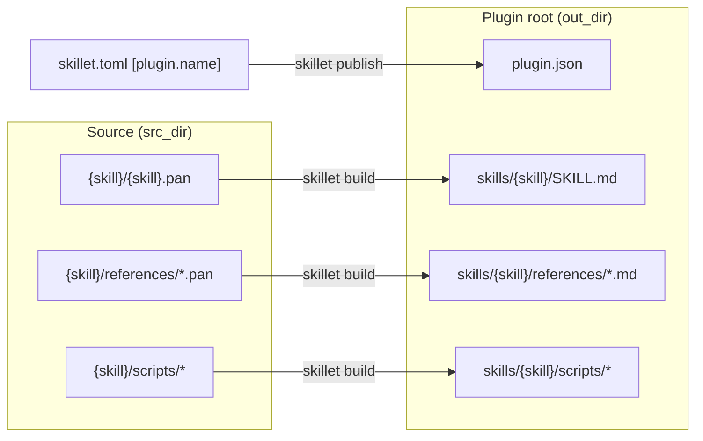

# 15 — Conform to the Agent Plugins standard

Make each published plugin a valid plugin under the [Agent Plugins specification v1.0.0](https://agent-plugins.org/specification). Skills are the only component type in scope. The skill format inside each plugin follows the [Agent Skills specification](https://agentskills.io/specification).

Each step must compile and pass `cargo test --workspace` before the next step starts.

---

## Current state and gaps

`skillet publish` writes `plugin.json` into the plugin `out_dir`. `skillet build` writes each skill to `{out_dir}/{skill}/SKILL.md`. The specification expects a different layout and a stricter manifest.

| Area | Current output | Specification | Severity |
|---|---|---|---|
| Manifest `$schema` | Not written | Required. Value: `https://agent-plugins.org/schemas/1.0.0/plugin.schema.json` | Fatal: a client rejects the plugin |
| Skill location | `{out_dir}/{skill}/SKILL.md` | `{plugin root}/skills/{skill}/SKILL.md` | Fatal: a client finds no skills |
| Manifest location | `{out_dir}/plugin.json` | `{plugin root}/plugin.json` | Correct if `out_dir` is the plugin root |
| Plugin name | Any TOML key | 1–64 chars, `a-z 0-9 - .`, starts and ends alphanumeric, no `--`, no `..` | Fatal if invalid |
| Optional manifest fields | `version`, `description` only | Also `author`, `homepage`, `repository`, `license`, `keywords`, `extensions` | Missing feature |
| Agents (`.agent.pan`) | Written to `{first out_dir}/agents/` | Not a v1 component. Client-specific content goes in a reverse-domain directory, for example `com.example.client/` | Not portable |
| Marketplace | `.claude-plugin/marketplace.json`, `.github/plugin/marketplace.json` | Not defined. Distribution is client-controlled | No change needed |
| Paths | Not checked | All paths must stay in the plugin root after symlink resolution | Missing check |

## Target layout

---

## Decisions to make before implementation

1. **Meaning of `out_dir`.** Recommendation: `out_dir` is the plugin root. Skills go to `{out_dir}/skills/`. This is a breaking change. In this repository, `out_dir = "skills"` changes to `out_dir = "."` (one plugin at the repository root) or to `plugins/skillet`.
2. **Default `out_dir` for `skillet init`.** Options: `"."` (single-plugin repository) or `"plugins/{name}"` (multi-plugin workspace). Recommendation: `"."`.
3. **Agents.** Agents are not a v1 component. Story 16 (`16-agent-definition-extension.md`) defines them as a skillet extension. For this story, stop writing agents to `{out_dir}/agents/`.
4. **Client manifests.** Claude Code and GitHub Copilot can expect their own manifest locations (for example `.claude-plugin/plugin.json`). Make sure that each client reads the root `plugin.json` before you remove client-specific output.
5. **MCP servers.** `mcp.json` is a v1 component. Recommendation: out of scope for this story. If necessary, copy a source `mcp.json` to the plugin root in a later story.
6. **`version`.** The specification makes `version` optional. Recommendation: keep it required in `skillet.toml`, because the marketplace entries use it.

Record decisions 1–3 in a new ADR `docs/adr/0006-agent-plugin-layout.md`. It replaces the "Plugin output namespacing" rejection in ADR-0005: the `skills/` directory stays flat, but it is now inside the plugin root.

---

## Step 1 — Rename `module` to `plugin` (done)

- [x] `[module.*]` → `[plugin.*]`, `ModuleConfig` → `PluginConfig`, `--module` → `--plugin`
- [x] Lint rules `cross-module-*` → `cross-plugin-*`
- [x] VS Code extension reads `plugin.*` sections
- [x] `CONTEXT.md`, `docs/reference.md`, ADR-0005, `migrate` skill updated

## Step 2 — Plugin name validation (lib)

Name rules are domain invariants. Put them in the lib crate.

- [ ] Add `crates/skillet/src/plugin.rs` with a `PluginName` newtype and `PluginName::parse(&str) -> Result<PluginName, PluginNameError>`
- [ ] `PluginNameError` has one variant per rule, each with a stable code: `empty`, `too-long`, `invalid-char`, `bad-boundary`, `double-hyphen`, `double-dot`
- [ ] `SkilletConfig::parse` validates every `[plugin.<name>]` key and returns an actionable message
- [ ] `init::derive_plugin_name` output always passes `PluginName::parse`
- [ ] Tests: the valid and invalid examples from the specification (`my-plugin`, `acme.tools`, `a`; `My-Plugin`, `-start`, `has--double`, `too.many..dots`)

## Step 3 — Plugin layout

- [ ] `discover_skills` sets `target_dir` to `{out_dir}/skills/{skill}`
- [ ] Agent output follows decision 3
- [ ] Lockfile paths follow the new target paths (`skillet.lock` is regenerated, not migrated)
- [ ] Output collision check in `build.rs` still compares full target paths
- [ ] `skillet init` writes the default `out_dir` from decision 2
- [ ] Update `skillet.toml` in this repository and rebuild. Delete the old `skills/{skill}/` output
- [ ] Integration test: `skillet build` writes `{out_dir}/skills/{skill}/SKILL.md`

## Step 4 — Manifest generation

Move manifest construction to the lib crate as a pure function. The CLI writes the file.

- [ ] Add `skillet::plugin::manifest(name: &PluginName, cfg: &PluginConfig) -> PluginManifest`
- [ ] `PluginManifest` serializes `$schema` first, then `name`, `version`, `description`, `author`, `homepage`, `repository`, `license`, `keywords`. Optional fields are left out when they have no value
- [ ] Add optional fields to `[plugin.<name>]`: `homepage`, `repository`, `license`, `keywords`, and `author` (table with `name`, `email`, `url`)
- [ ] Do not add `extensions` until a client needs it
- [ ] `publish.rs` writes `{out_dir}/plugin.json` from `PluginManifest`
- [ ] Marketplace entry `source` points to the plugin root (`./{out_dir}`)
- [ ] Test: validate the generated `plugin.json` against a vendored copy of `plugin.schema.json` in `crates/skillet-cli/tests/fixtures/`. Do not download the schema during tests

## Step 5 — Validation of published plugins

- [ ] Lint rule `skill-name-mismatch`: the frontmatter `name` must equal the skill directory name (confirm the rule in the Agent Skills specification first)
- [ ] Lint rule `path-escapes-plugin`: `ref::` targets, scripts and symlinks must resolve inside the plugin root
- [ ] `cross-plugin-fragment-ref` stays a warning. Fragments are inlined during the build, so a published plugin is self-contained. Look again at whether this rule is still necessary
- [ ] `skillet publish` stops with an error if a plugin name or manifest is not valid

## Step 6 — Documentation

- [ ] `CONTEXT.md`: add **Plugin root** and update **Plugin manifest** (`$schema`, new fields)
- [ ] `docs/reference.md`: new `[plugin.<name>]` fields, output layout, name rules
- [ ] ADR-0006 with decisions 1–3
- [ ] `migrate` skill: steps to move from `[module.*]` and the old output layout
- [ ] `README.md`: link to the Agent Plugins specification

---

## Open items

- The Agent Skills specification (frontmatter fields, name rules) was not read for this plan. Read it before step 5.
- Make sure that Claude Code and GitHub Copilot load a plugin that has only a root `plugin.json` (decision 4).
- `url_verification_example_fails_with_strict` in `examples_tests` fails on `main` before this work. Fix or quarantine it separately.
