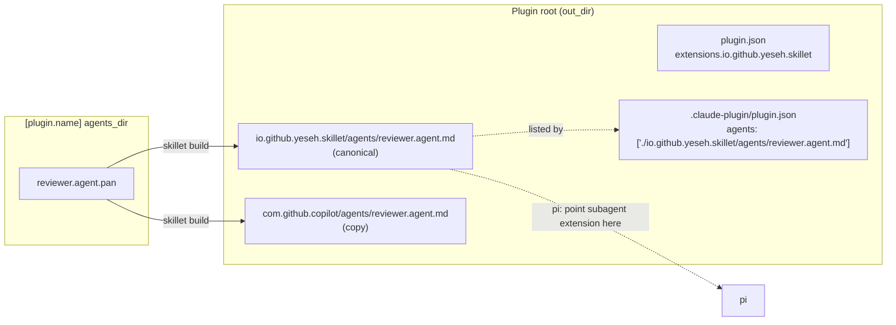

# 16 — Agent definition extension

Add **agent definitions** to plugins. An agent definition is a Markdown file with YAML frontmatter. The body is the system prompt of the agent. Skillet compiles one source file into a form that GitHub Copilot, Claude Code and pi can load.

Agent Plugins v1 has no portable agent component. The specification puts agents with other client-specific content, in a reverse-domain extension directory. This story defines a skillet-owned extension namespace for agent definitions. It also adds the output that each harness needs to find the agents.

Depends on story 15 (plugin root layout). Each step must compile and pass `cargo test --workspace` before the next step starts.

---

## Research summary

Sources were read on 2026-11-21:

- Agent Plugins: <https://agent-plugins.org/specification> §7, §8 and <https://agent-plugins.org/plugin-authors/client-extensions>
- Claude Code: <https://code.claude.com/docs/en/sub-agents.md>, <https://code.claude.com/docs/en/plugins-reference.md>
- GitHub Copilot: <https://docs.github.com/en/copilot/reference/custom-agents-configuration>, <https://docs.github.com/en/copilot/reference/copilot-cli-reference/cli-plugin-reference>, <https://code.visualstudio.com/docs/agents/reference/agent-plugin-reference>
- pi: `badlogic/pi-mono` at commit `780bf31` (`@earendil-works/pi-coding-agent` 1.6.0), `packages/coding-agent/examples/extensions/subagent/`

### Agent Plugins rules that apply

- v1 defines only skills and MCP servers. Agents are "too client-specific for a stable portable contract" (§7 rationale).
- Client-specific files MUST be in a top-level directory with the same name as the reverse-domain namespace (§8). Client-specific manifest data MUST be in `extensions.<namespace>` (§8).
- A client MUST ignore namespaces that it does not implement (§8.1). Thus, an extension directory does not break other clients.
- The namespace SHOULD be based on a domain that the owner controls (§8). The specification has no registry and no versioning for extensions.

### Where each harness finds plugin agents

| Harness | Plugin agent location | Identity |
|---|---|---|
| GitHub Copilot (CLI, VS Code) in Agent Plugins mode (root `plugin.json` with the v1 `$schema`) | `com.github.copilot/agents/*.agent.md` | File name without `.agent.md` |
| GitHub Copilot, legacy plugin mode | `agents/` or the `agents` field in `plugin.json` | File name |
| Claude Code | `agents/*.md`, or the `agents` field in `.claude-plugin/plugin.json`: an array of `./`-relative `.md` file paths that replaces the `agents/` scan | `name` field, with plugin prefix: `<plugin>:<name>` |
| pi | No plugin support. The `subagent` example extension reads `.pi/agents/*.md` (nearest upward) and `~/.pi/agent/agents/*.md`. pi packages cannot ship agents | `name` field |

### Frontmatter compatibility

| Field | Claude Code | GitHub Copilot | pi (`subagent` extension) | Skillet |
|---|---|---|---|---|
| `name` | Required. Max 256, no `:`, does not start with `-` | Optional. Default is the file name. File name chars: `a-z A-Z 0-9 . - _` | Required string | **Required.** Portable rule (below). Must equal the file name |
| `description` | Required | Required | Required string | **Required** |
| `tools` | Comma string or YAML list. Omitted = all tools | Comma string or YAML list. Omitted or `["*"]` = all. Unknown names are ignored | Comma string or YAML list. Omitted or empty = default tools. Unknown names match nothing | **Pass-through** |
| `model` | `sonnet`, `opus`, `haiku`, `fable`, `inherit` or a model ID | Model ID. Possibly ignored on github.com | `--model` pattern: `provider/id`, optional `:<thinking>` | **Pass-through** |
| Unknown fields | Ignored | Ignored (not verified for all surfaces) | Ignored | **Pass-through** |
| Body | Replaces the default system prompt | Agent instructions. Max 30,000 characters | Appended to the pi system prompt | System prompt |

Fields that only one harness uses (for example `disallowedTools`, `permissionMode`, `color`, `effort`, `skills`, `target`, `user-invocable`, `disable-model-invocation`, `mcp-servers`, `handoffs`) are passed through without change. Each harness decides what to do with them.

### Known incompatibilities

These are accepted. Skillet does not translate them. The documentation must tell authors about them.

1. **Tool names are different.** Claude Code uses `Read`, `Edit`, `Bash`. pi uses `read`, `edit`, `bash`. Copilot accepts both forms as aliases. If an agent lists only Claude Code names, pi gives the agent **no tools**, because no name matches. If no name matches in Claude Code, the agent does not start.
2. **Model values are different.** A model alias for one harness is not valid for the others. Leave out `model` for an agent that must work in all harnesses.
3. **Body semantics are different.** pi appends the body to its system prompt. Claude Code and Copilot use the body as the full agent instructions.
4. **Claude Code ignores some fields for plugin agents:** `hooks`, `mcpServers`, `permissionMode`, `initialPrompt`.
5. **pi cannot load agents from a plugin.** pi users must point the `subagent` extension at the agent directory, or copy the files.

---

## Design

### Terms

Add these to `CONTEXT.md`:

- **Agent definition**: A Markdown file with YAML frontmatter (`name`, `description`, optional pass-through fields) and a body that is the agent's system prompt. Compiled from an **agent source**.
- **Agent source**: A `{name}.agent.pan` file in the plugin `agents_dir`. Uses the same directives as a skill source, except `ref::`.
- **Harness**: A program that runs agents and loads plugins, for example Claude Code, GitHub Copilot or pi.
- **Agent extension**: The skillet-owned Agent Plugins extension namespace that holds agent definitions.

### Source and output layout



- `io.github.yeseh.skillet` is the skillet agent extension namespace (decision 1).
- The canonical file is the only file that the agent extension defines. The Copilot copy is the same file at the path that Copilot reads. Claude Code reads the canonical file through the `agents` list, so no copy is necessary.
- The file name is `{name}.agent.md`. Copilot needs this suffix. Claude Code and pi read any `.md` file.

### Agent extension format (version 1)

- Directory: `io.github.yeseh.skillet/agents/`. Each regular file `{name}.agent.md` directly in this directory is one agent definition. Subdirectories are not scanned.
- Manifest entry: `plugin.json` contains `"extensions": { "io.github.yeseh.skillet": { "version": 1 } }`.
- Frontmatter:
  - `name` (string, required): 1–64 characters, `a-z`, `0-9` and `-`. It starts and ends with a letter or digit and has no `--`. It must equal the file name without `.agent.md`. All three harnesses accept this rule.
  - `description` (string, required): not empty.
  - All other fields: optional. Skillet writes them without change, in source order.
- Body: the system prompt. Maximum 30,000 characters (the Copilot limit).

### Configuration

```toml
[plugin.my-plugin]
src_dir = "src/skills"
out_dir = "."
version = "0.1.0"
agents_dir = "src/agents"   # new, optional
```

Agents belong to a plugin. The workspace-level `agents/` directory that `Workspace::resolve` reads now is removed.

---

## Decisions (2026-11-21)

1. **Namespace identifier:** `io.github.yeseh.skillet`. Do not change it after the first release.
2. **Claude Code delivery:** write `.claude-plugin/plugin.json` with an `agents` list that points at the canonical files. Do not copy the files. Look at this decision again if story 15 decision 4 shows that Claude Code reads the root `plugin.json`.
3. **pi delivery:** canonical files only. The documentation tells pi users how to point the `subagent` extension at them. A pi package that loads agents from installed plugins can be a later story.
4. **Tool lists:** pass through without change. No per-harness overrides. Look at this decision again if the pi "no tools" problem causes support requests.

Record decisions 1–3 in ADR `docs/adr/0007-agent-definition-extension.md`.

---

## Step 1 — ADR and terms

- [ ] Write ADR-0007 with the decisions above
- [x] Choose the namespace identifier
- [ ] Add the terms to `CONTEXT.md`
- [x] Update story 15 decision 3 to point to this story

## Step 2 — Agent definition type (lib)

- [ ] Add `crates/skillet/src/agent.rs` with `AgentDefinition { name: AgentName, description: String, fields: serde_yaml::Mapping, body: String }`. `fields` keeps the pass-through fields in source order
- [ ] `AgentName::parse` applies the name rule. Error codes: `empty`, `too-long`, `invalid-char`, `bad-boundary`, `double-hyphen`
- [ ] `AgentDefinition::parse(compiled: &str) -> Result<AgentDefinition, AgentError>`. Error codes: `missing-frontmatter`, `invalid-yaml`, `missing-name`, `missing-description`, `body-too-long`
- [ ] `AgentDefinition::render() -> String` writes `name`, `description`, then `fields`, then the body
- [ ] Tests: round trip keeps unknown fields and their order. Each error code has one test

## Step 3 — Discovery

- [ ] Add `agents_dir: Option<String>` to `PluginConfig`
- [ ] Discover `{agents_dir}/{name}.agent.pan` for each plugin. Stamp the plugin name on each agent, as for skills
- [ ] Remove discovery from the workspace-level `agents/` directory
- [ ] Output collision check: two agents with the same name in one plugin is a build error

## Step 4 — Build

- [ ] Compile each agent source with the skill compiler. `ref::` is a build error in an agent source
- [ ] Parse the result with `AgentDefinition::parse`. Stop with the error code and the source path if it fails
- [ ] Write `{out_dir}/io.github.yeseh.skillet/agents/{name}.agent.md` and `{out_dir}/com.github.copilot/agents/{name}.agent.md`
- [ ] Add agent entries to `skillet.lock` (source hash, compiled hash, token count)
- [ ] Integration test: one agent source gives the two output files with the same content

## Step 5 — Publish

- [ ] Add `extensions.io.github.yeseh.skillet` with `version: 1` to the generated `plugin.json` when the plugin has agents
- [ ] Claude Code output for decision 2
- [ ] Test: the generated `plugin.json` is valid against the vendored `plugin.schema.json`

## Step 6 — Lint

- [ ] `agent-name-mismatch` (error): `name` is not equal to the file name
- [ ] `agent-body-too-long` (error): body is longer than 30,000 characters
- [ ] `agent-field-ignored-by-claude` (warning): the frontmatter has `hooks`, `mcpServers`, `permissionMode` or `initialPrompt`. Claude Code ignores these fields for plugin agents
- [ ] `skill::` in an agent source must point to a skill in the same plugin (same rule as `cross-plugin-skill-ref`)

## Step 7 — Documentation

- [ ] `docs/reference.md`: `agents_dir`, agent source, frontmatter rules, output layout
- [ ] New page `docs/agent-extension.md`: the extension format (version 1), the compatibility tables and the known incompatibilities from this story
- [ ] pi setup instructions for decision 3
- [ ] `migrate` skill: move agents from the workspace `agents/` directory to a plugin `agents_dir`

---

## Open items

- Not verified: Claude Code reads a root `plugin.json` with the Agent Plugins `$schema`. If it does, decision 2 can change.
- Not verified: Copilot accepts unknown frontmatter fields on all surfaces (github.com, CLI, VS Code). If a surface rejects them, add a filter for that copy only.
- Not verified: Claude Code starts an agent when some, but not all, `tools` entries are unknown.
- `[workspace.publish].agents` lists harnesses (`claude`, `github-copilot`), not agents. The name can cause confusion with agent definitions. Consider a rename to `harnesses` in a separate change.
- Budget (`skillet budget`) does not count agents. Add this in a later story if necessary.
